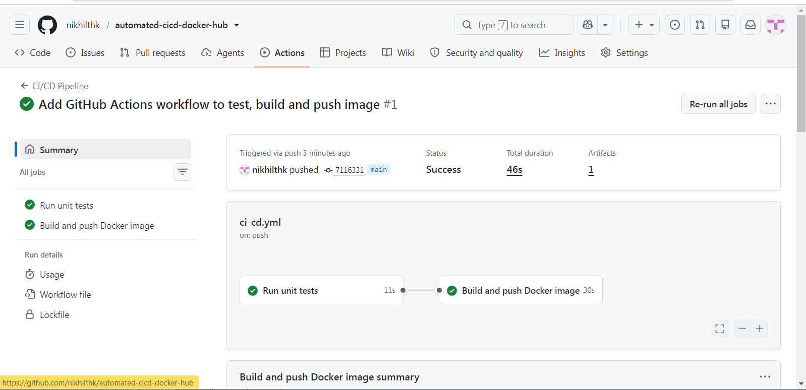
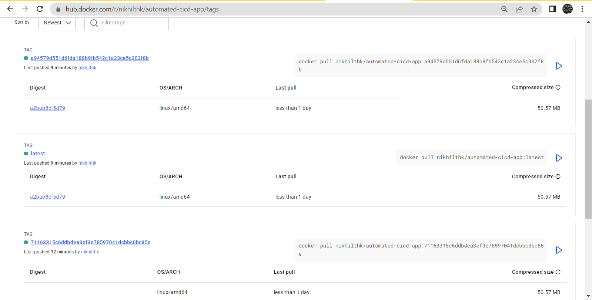
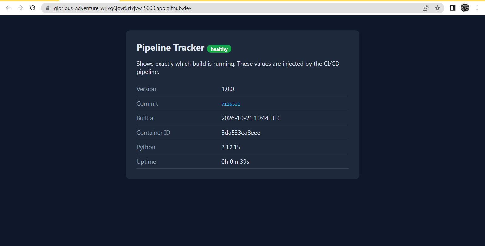
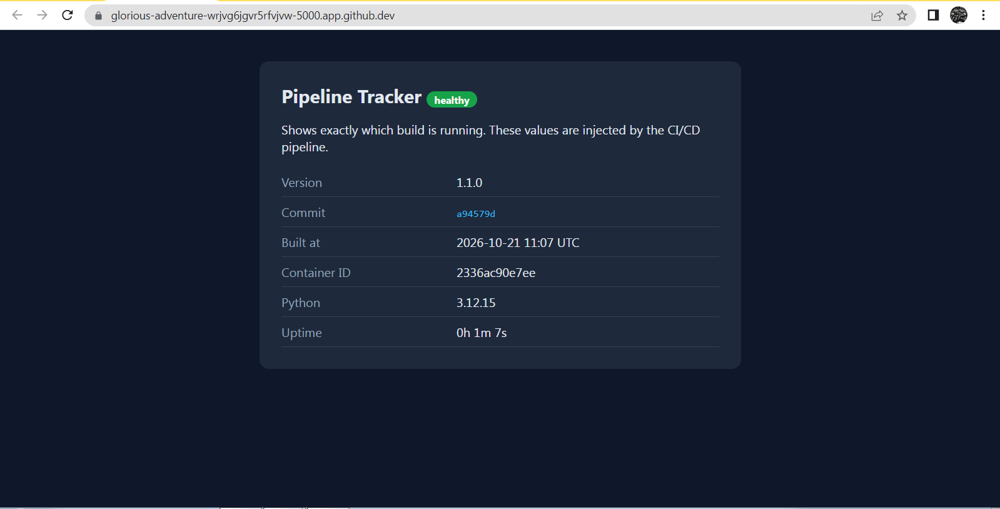

# Automated CI/CD Pipeline with GitHub Actions and Docker Hub


A small Flask app with a complete CI/CD pipeline around it. Every push to `main` runs the tests, builds a Docker image and pushes it to Docker Hub automatically.

Built as Project 4 (CI/CD Pipeline with GitHub Actions & Docker) of the Elevate Labs DevOps internship.

**Docker image:** https://hub.docker.com/r/nikhilthk/automated-cicd-app

## Overview

I built this project to understand how code travels from a commit to a running container without anyone doing it by hand.

The app is called Pipeline Tracker. It is a simple web page that shows which build is running: the version, the Git commit, the build time, the container ID and the uptime. The pipeline passes the commit SHA and build time into the Docker image while building it, so after a deploy I can open the page and see exactly which commit is live.

## Pipeline flow

```
git push to main
      |
      v
GitHub Actions starts
      |
      v
Job 1: run unit tests (pytest)
      |  tests pass
      v
Job 2: build the Docker image
      |
      v
Push to Docker Hub (tags: latest and the commit SHA)
      |
      v
Pull the image and run the container
```

If the tests fail, the build job never starts, so a broken version is not published.

## Tools used

| Tool | What I used it for |
|---|---|
| GitHub | Source code and version control |
| GitHub Actions | Runs the CI/CD workflow on every push |
| Docker | Packages the app into an image |
| Docker Compose | Builds and runs the app locally with one command |
| Docker Hub | Stores the built images |
| Python and Flask | The web app |
| pytest | Unit tests |
| gunicorn | Production web server inside the container |
| GitHub Codespaces | Development environment |

## Project structure

```
.
├── .github/workflows/ci-cd.yml   # the pipeline
├── templates/index.html          # the web page
├── app.py                        # Flask app
├── test_app.py                   # unit tests
├── requirements.txt
├── Dockerfile
├── docker-compose.yml
├── .dockerignore
└── docs/screenshots/             # proof screenshots
```

## How it works

- **Tests first.** The `test` job installs dependencies and runs pytest. The `build-and-push` job has `needs: test`, so it only runs if the tests pass.
- **Build arguments.** The commit SHA and build time are passed into the image as build arguments and stored as environment variables. The app reads them and shows them on the page.
- **Two tags.** Each image is pushed with the `latest` tag and with the full commit SHA, so I can always go back to the exact build for a commit.
- **Secrets.** The Docker Hub username and access token are stored in GitHub Actions secrets. They are not in the code.
- **Container basics.** The container runs as a non-root user, uses gunicorn instead of Flask's development server, and has a health check.
- **Build cache.** The workflow caches Docker layers, so repeat builds are faster.

## How to run it

**Option 1: pull the image from Docker Hub**

```bash
docker run -p 5000:5000 nikhilthk/automated-cicd-app:latest
```

Then open http://localhost:5000

**Option 2: build it yourself**

```bash
git clone https://github.com/nikhilthk/automated-cicd-docker-hub.git
cd automated-cicd-docker-hub
docker compose up --build
```

**Run the tests**

```bash
pip install -r requirements.txt
pytest -v
```

**Set it up on your own fork**

Add two repository secrets under Settings, Secrets and variables, Actions:

- `DOCKERHUB_USERNAME`: your Docker Hub username
- `DOCKERHUB_TOKEN`: a Docker Hub access token with read and write access

## Screenshots

**Pipeline run: both jobs passed**



**Image published on Docker Hub with the `latest` and commit SHA tags**



**First version deployed from Docker Hub (version 1.0.0, commit 7116331)**



**After changing the version and pushing, the pipeline redeployed (version 1.1.0, commit a94579d)**



## What I would add next

- A vulnerability scan of the image with Trivy before it is pushed
- Deploying the image to a Kubernetes cluster such as Minikube

## Author

Nikhil Chauhan  
GitHub: [nikhilthk](https://github.com/nikhilthk)